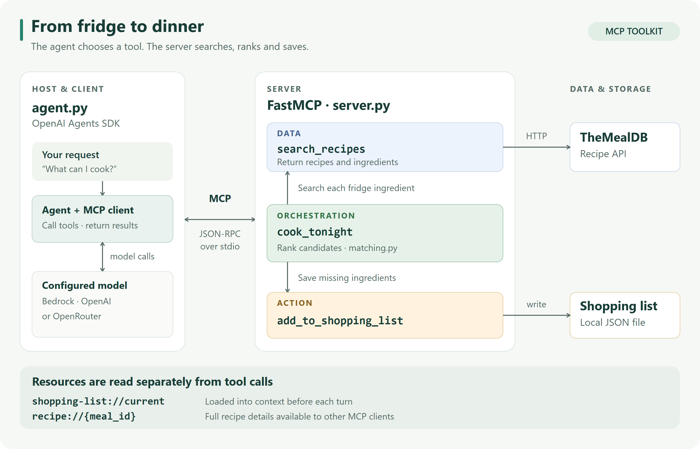

# FridgeChef

**Turn what is in your fridge into dinner, and save what is missing.**

A recipe assistant with three MCP tools: find recipes, build a shopping list, or plan a meal in one request. Built with **FastMCP**, the **OpenAI Agents SDK** and [TheMealDB](https://www.themealdb.com/api.php).

[Quick start](#quick-start) · [How it works](#how-it-works) · [Demo](#demo) · [Tests](#tests-and-evaluation) · [Documentation](#documentation)



*[View the vector diagram](docs/assets/architecture.svg). The orchestration tool calls the search and shopping functions inside the server; those internal calls do not make additional MCP round trips.*

## Quick start

Run these commands from the project directory. Expand the instructions for your shell.

<details open>
<summary><strong>Windows · PowerShell</strong></summary>

```powershell
python -m venv .venv
.\.venv\Scripts\Activate.ps1
pip install -r requirements.txt
Copy-Item .env.example .env
```

</details>

<details>
<summary><strong>macOS / Linux</strong></summary>

```bash
python -m venv .venv
source .venv/bin/activate
pip install -r requirements.txt
cp .env.example .env
```

</details>

Edit `.env` with credentials for **one model provider**. The default is AWS Bedrock; OpenAI and OpenRouter are also supported. TheMealDB needs no account key.

<details>
<summary><strong>Provider settings and default models</strong></summary>

| Provider | Set in `.env` | Default model |
|---|---|---|
| **AWS Bedrock** (default) | `LLM_PROVIDER=bedrock`, `AWS_REGION`, `AWS_BEARER_TOKEN_BEDROCK` | Claude Haiku 4.5 |
| **OpenAI** | `LLM_PROVIDER=openai`, `OPENAI_API_KEY` | `gpt-4o-mini` |
| **OpenRouter** | `LLM_PROVIDER=openrouter`, `OPENROUTER_API_KEY` | `openai/gpt-4o-mini` |

Override the model with `BEDROCK_MODEL_ID`, `OPENAI_MODEL` or `OPENROUTER_MODEL`. Bedrock also accepts AWS access keys or a profile instead of a bearer token. Keep credentials in `.env`, which is ignored by Git.

For the tested dependency versions, install `requirements-lock.txt` instead of `requirements.txt`.

</details>

Start a conversation, or send a single request:

```bash
python agent.py
python agent.py "I have chicken, rice, garlic and onion. What can I cook?"
```

## How it works

| Category | Tool | What it does |
|---|---|---|
| **Data** | `search_recipes` | Finds recipes for an ingredient and returns full ingredient lists. |
| **Action** | `add_to_shopping_list` | Saves shopping items, skipping duplicates. |
| **Orchestration** | `cook_tonight` | Searches fridge ingredients, ranks the candidates and saves the selected recipe's missing ingredients. |

The agent chooses a tool from your request. Its MCP client sends the call to the FastMCP server over **stdio**, receives a structured result and passes it back to the model for the answer. Each tool has typed inputs and explicit errors for invalid input or unavailable resources.

`cook_tonight` rewards using fridge ingredients and penalizes extra purchases and unused proteins. It assumes pantry staples, excludes recipes that use none of the available non-staple ingredients, and saves only what the selected meal needs. See the [scoring rules and matching limits](docs/design.md#candidate-selection-and-scoring).

The server also exposes two **MCP resources**:

| Resource | Use |
|---|---|
| `shopping-list://current` | Read by the host before each turn and supplied as context. The list is stored in `data/shopping_list.json`. |
| `recipe://{meal_id}` | Full recipe and instructions, available to other MCP clients. |

Matching is heuristic: quantities and dietary restrictions are not checked, and the best recipe in the sampled candidates may differ from the best in the entire catalogue. [Design notes](docs/design.md) explain the boundaries.

## Demo

```bash
python demo.py
```

Press **Enter** to advance through recipe search, dinner planning, resource reads, a follow-up, an explicit shopping request and an empty-result case. The demo uses an isolated shopping list and shows the server's requests and replies.

| Command | Purpose |
|---|---|
| `python agent.py --trace` | Chat with MCP request and response logs. |
| `python demo.py --auto` | Run the demonstration without pressing Enter. |
| `python demo.py --no-trace` | Hide the server-side request log. |
| `python server.py` | Launch the server for another MCP client. |

In chat, use `list` to read the shopping-list resource, `reset` to clear the conversation, and `quit` to exit. Resetting the conversation keeps the saved shopping list.

## Tests and evaluation

| Check | Latest recorded result | Requires |
|---|---|---|
| Offline tool, MCP and host tests | **206 passed** | No API credentials |
| Live recipe and matching tests | **27 passed** | TheMealDB access |
| Agent evaluation | **11 cases × 2 runs per model** | Model credentials and TheMealDB access |

Run the offline suite:

```bash
pytest -q
```

<details>
<summary><strong>Run live recipe tests or compare models</strong></summary>

Enable the additional live tests in PowerShell:

```powershell
$env:RUN_LIVE="1"
pytest -q
```

On macOS / Linux: `RUN_LIVE=1 pytest -q`.

Run model evaluations:

```bash
python eval_routing.py --runs 2
python eval_routing.py --provider openrouter --model openai/gpt-4o-mini --runs 2
python eval_routing.py --provider bedrock --model openai.gpt-oss-120b-1:0 --runs 2
```

The evaluator saves local transcripts under the Git-ignored `eval-results/` directory. Automated routing and tool checks are assessed separately from the final answers.

</details>

The [evaluation report](docs/evaluation.md) compares four models and records failures, review limits and the budget retry in the GPT-4o-mini run. Correct tool use alone does not establish a correct final answer.

## Documentation

| Read | What it covers |
|---|---|
| [MCP summary and server critique](docs/summary.md) | Protocol concepts and analysis of an existing server. |
| [Design](docs/design.md) | Tool boundaries, matching, scoring, persistence and limitations. |
| [Ingredient families](docs/families.md) | Supported aliases, product distinctions and exclusions. |
| [Evaluation](docs/evaluation.md) | Test coverage, model results and their limits. |
| [Reflection](docs/reflection.md) | Implementation decisions and lessons learned. |

<details>
<summary><strong>Project files</strong></summary>

| File | Purpose |
|---|---|
| [`agent.py`](agent.py) | Model configuration, MCP client and chat loop. |
| [`server.py`](server.py) | Three tools, resources and request tracing. |
| [`matching.py`](matching.py) | Ingredient matching and recipe scoring. |
| [`demo.py`](demo.py) | Paced demonstration of the three tool categories. |
| [`eval_routing.py`](eval_routing.py) | Live routing and tool-result checks. |
| [`tests/`](tests/) | Offline tests, catalogue fixture and live recipe benchmarks. |

</details>

---

Built for **EECE 503P/798S · Assignment C5**. The required 5–7 minute screencast is a separate deliverable; `demo.py` provides the demonstration flow.
